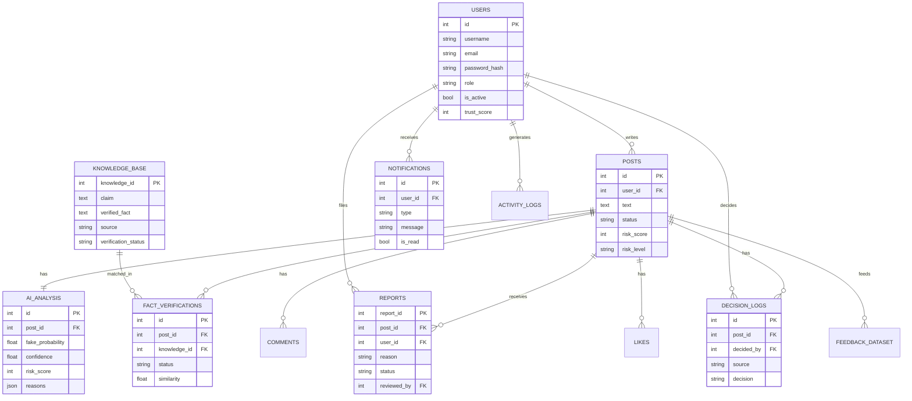

# 03 - Database design (PostgreSQL)

Collections requested in the brief are implemented as relational tables. Admins/moderators are `users.role`
(no separate `admin_users` table). Extra table: `feedback_dataset`.

Full DDL: [`database/schema.sql`](../database/schema.sql). Posts are soft-deleted (`status = REMOVED`) to keep the audit trail.
